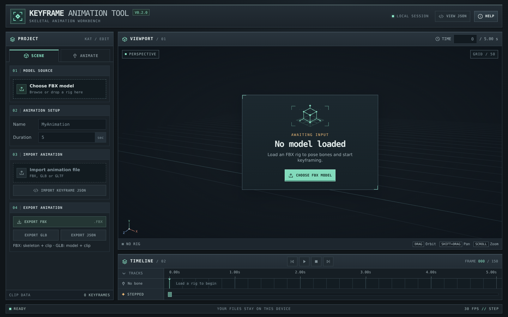

# Keyframe Animation Tool

A browser-based editor for posing FBX rigs, building skeletal animations, and exporting clips. Models and animations are processed on your device.



## Run it locally, offline

Download `keyframe-animation-tool-v0.2.0.html` from the [v0.2.0 release](https://github.com/rubiidev18alt/keyframe-animation-tool/releases/tag/v0.2.0) and open it in a current browser with WebGL support. No installer, server, Node.js, or internet connection is needed. Keep your rig and saved animations separately from the app file.

## Edit an animation

1. In **Scene**, pick or drop an FBX model with a skeleton. Give the clip a name and duration.
2. In **Animate**, select a bone. Change its local rotation using the viewport gizmo or the rotation fields. Position is read-only in the editor; imported clips can include position keys.
3. Select a time and click **Set Key**. Repeat at other times and on other bones. Use **Tracks** in the timeline to see all animated bones.
4. Click a key marker to jump directly to its time and pose. Scrubbing and playback are **stepped**: each channel holds its last keyed value until its next key. Before a channel's first key, it uses that first value. No movement setting is needed.
5. Return to **Scene** to export. You can also import an FBX/GLB animation (or a self-contained GLTF) for the matching rig, or paste keyframe JSON. If a file has multiple clips, the first is loaded.

| Export | Includes | Use it for |
| --- | --- | --- |
| **FBX** | Binary FBX 7.4, original skeleton hierarchy and names, and one clip with stepped rotation and translation curves | Applying the clip to the matching rig in other 3D tools. No mesh, skin weights, or textures. |
| **GLB** | Model and animation, with STEP interpolation | Moving a rigged model and clip together. |
| **JSON** | Editable position and rotation keyframes | Saving your work for re-import into this tool. |

Some 3D applications resample FBX curves on import. If you need the stepped look, keep constant interpolation or disable resampling where your importer supports it.

### Keyboard shortcuts

| Shortcut | Action |
| --- | --- |
| `Space` | Play / pause |
| `S` or `K` | Set or update a keyframe |
| `Delete` / `Backspace` | Remove the selected bone's key at the playhead |
| `←` / `→` | Previous / next frame (30 fps reference) |
| `Shift` + `←` / `→` | Jump by 0.1 seconds |
| `Home` / `End` | Start / end of the timeline |

## Develop and build

Use Node.js 22 and npm:

```sh
git clone https://github.com/rubiidev18alt/keyframe-animation-tool.git
cd keyframe-animation-tool
npm ci
npm run dev
```

- `npm run lint` checks the source. `npm test` checks stepping, keyframe imports, and FBX round-tripping.
- `npm run build` creates the static website in `dist/`. `npm run preview` serves that build for testing.
- `npm run build:local` creates the standalone `build/local/index.html`. Rename the HTML as desired and open it directly, or attach it to a GitHub release.

## Publish the website on GitHub Pages

In [repository Settings → Pages](https://github.com/rubiidev18alt/keyframe-animation-tool/settings/pages), set **Build and deployment → Source** to **GitHub Actions**. After the change is merged into `main`, the **Build and deploy Pages** workflow can deploy on a push to `main` or be run manually from the Actions tab. The website URL is [rubiidev18alt.github.io/keyframe-animation-tool/](https://rubiidev18alt.github.io/keyframe-animation-tool/) once deployment succeeds.

## License

[MIT](LICENSE).
